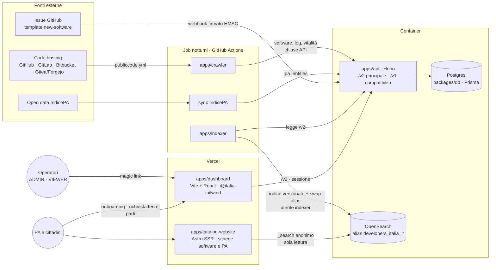

# Piano: developers-italia-software-catalog

Riscrittura, con l'obiettivo di farlo evolvere, dell'intero sistema del Catalogo del software pubblico dentro un unico monorepo TypeScript/Bun, con licenza **AGPL-3.0-or-later**.

Il funzionamento attuale, insieme a bug e problemi di sicurezza (indicati con codici come **S1**, **B2**…), è descritto in [how-it-works.md](how-it-works.md).

Questo documento sta nella root del monorepo `developers-italia-software-catalog`.

**Stato al 9 novembre 2026.** Il giro funziona in locale dall'inizio alla fine: import dei dati di produzione → API v2 → crawler TS → indexer → OpenSearch → dashboard. Provato su 8 publisher reali (GitHub, gitlab.com, GitLab su domini propri, Bitbucket), con l'indice locale che riproduce quello di produzione (576 software, 104 amministrazioni). Mancano ancora soprattutto: vitalità, controlli di rete del validatore, API v1, autenticazione e onboarding nella dashboard.

---

## 1. Obiettivo

Sostituire i progetti attuali con un monorepo che sia un'**infrastruttura completa e avviabile in locale**:

| Oggi | Domani (monorepo) |
|---|---|
| `publiccode-crawler` (Go, non mantenuto) | `apps/crawler`: crawler in TypeScript |
| `developers-italia-api` (Go, non mantenuto) | `apps/api`: Hono + Prisma + Postgres. **`/v2` è l'API principale**; `/v1` resta come livello di compatibilità durante la migrazione |
| Action notturna di `developers.italia.it` (Jekyll, in deprecazione) | `apps/indexer` + GitHub Action notturna nel monorepo |
| `developers.italia.it-data`: import IndicePA → `indicepa_pec` | Sync IndicePA → Postgres (`ipa_entities`) dentro il monorepo |
| `developers.italia.it-data`: dati community GitHub + `_data/*.yml` del vecchio sito | Da decidere (**D13**): codice versionato, DB + dashboard, oppure fuori dal perimetro |
| `catalogo-software` | `apps/catalog-website`: stesso progetto, con in più le pagine PA |
| `onboarding-italia` (Next.js) | `apps/dashboard`: area pubblica di onboarding |
| Issue template GitHub `add_new_software` | `apps/dashboard`: form pubblico **e** issue GitHub intercettate e censite nella stessa coda di richieste |
| (nessuno strumento di amministrazione) | `apps/dashboard`: area riservata con CRUD di software, amministrazioni e cataloghi |
| Postgres e OpenSearch gestiti a parte | `compose.yaml` (base, sicurezza attiva) + `compose.local.yaml` (sviluppo: porte, Dashboards, Mailpit) |

### Architettura obiettivo



- Un solo punto di scrittura: crawler, sync IndicePA, integrazione GitHub e dashboard passano dall'API, che è l'unica a scrivere in Postgres (principio 2). Unica eccezione, solo in sviluppo: `bun run db:import`, che copia i dati di produzione direttamente nel database.
- Ogni notte il crawler aggiorna l'API, poi l'indexer ricostruisce l'indice e sposta l'alias.
- Il catalogo pubblico legge OpenSearch senza credenziali e può solo cercare sull'alias (D2); le schede vengono renderizzate dal server di Astro (D12).
- Hosting (D9): API, Postgres e OpenSearch come container o servizi gestiti; catalogo e dashboard su Vercel.

### Principi
1. **v2 come obiettivo, v1 come ponte.** La v2 è progettata da zero (design-first) sui bisogni nuovi: dashboard, richieste, PA, vitalità. La v1 implementa lo stesso contratto della Go (`open-catalog-api.oas.yaml`) sullo **stesso schema di database**, come adattatore sottile sopra i servizi della v2. Così si sostituisce l'API Go senza migrare i dati e senza rompere i client attuali (crawler Go, onboarding, `publiccode-issueopener`, chi è iscritto ai webhook); poi la v1 si dichiara deprecata e si rimuove.
2. **Un solo punto di scrittura.** Tutte le scritture passano dall'API, così eventi, webhook e validazione restano in un posto solo. Crawler, indexer, dashboard e integrazione GitHub sono client dell'API.
3. **Sostituzione graduale** (pattern *strangler*): ogni pezzo nuovo va in produzione affiancando il vecchio e poi lo sostituisce. Nessun cutover "big bang".
4. **Correzioni insieme al porting**: i problemi di how-it-works.md si chiudono nel pezzo che li contiene (tabella di tracciamento al §6).
5. **Un solo database.** Da questa versione richieste di onboarding, storico degli stati, richieste di software di terze parti, utenti e sessioni della dashboard stanno **nello stesso Postgres dell'API**, accanto a software e publisher. Oggi l'onboarding ha un database separato e senza storico. La dashboard non ha un database né un server suoi: parla solo con l'API.

---

## 2. Struttura del monorepo

```
developers-italia-software-catalog/
├── apps/
│   ├── api/                @sw-catalog/api              Hono + Prisma
│   │   ├── src/v2/                                       API principale
│   │   ├── src/v1/                                       compatibilità con la Go
│   │   ├── openapi/v2/openapi.yaml                       contratto v2 (design-first)
│   │   └── openapi/v1/open-catalog-api.oas.yaml          contratto v1 (riferimento)
│   ├── crawler/            @sw-catalog/crawler          CLI Bun
│   ├── indexer/            @sw-catalog/indexer          export API → OpenSearch
│   ├── catalog-website/    @sw-catalog/catalog-website  React + Vite (ex catalogo-software)
│   └── dashboard/          (da inizializzare)           admin + onboarding + terze parti
├── packages/
│   ├── db/                 @sw-catalog/db               schema Prisma, client, migration
│   ├── publiccode-validator/ @sw-catalog/publiccode-validator  validazione con publiccode-schema-v0 (Fase 1c)
│   └── shared/             @sw-catalog/shared           costanti, tipi, schemi zod condivisi
├── .github/workflows/      ci.yml (+ index-opensearch.yml, crawl.yml, sync-ipa.yml)
├── compose.yaml            base sicura: postgres · opensearch (security plugin) · opensearch-setup
├── compose.local.yaml      solo sviluppo: porte · [tools] dashboards · [mail] mailpit
├── infra/opensearch/       config di sicurezza (accesso anonimo) e setup di ruoli e utenti
├── LICENSE                 AGPL-3.0
└── .env.example
```

**Convenzione dei nomi:** tutto ciò che ha il prefisso "publiccode" si scrive con la **doppia c** (`publiccode-schema`, `publiccode-validator`, `publiccode.yml`).

Fuori dal monorepo, come dipendenza npm: **`publiccode-schema`** (vedi Fase 1c).

Da aggiungere con la Fase 6: `packages/mailer` (invio SMTP con nodemailer + template MJML/Handlebars ripresi da onboarding-italia, usato dall'API per magic link ed email di onboarding).

Da aggiungere più avanti, se servono: `packages/ui` (componenti Bootstrap Italia condivisi da catalog-website e dashboard), `packages/reference-data` (tassonomie, vedi D13), `infra/opensearch` (mappings e settings versionati).

---

## 3. Decisioni

Tutte prese il 9 novembre 2026, tranne D11 che resta facoltativa.

| # | Tema | Decisione | Conseguenze nel piano |
|---|---|---|---|
| D1 | Framework della dashboard | ✅ **Vite + React 19 + React Router 7**, tabelle con **`@simple-table/react`** (MIT), stile **`@italia-tailwind/css`** (Tailwind 4 + daisyUI 5, classi `ita-*`, tema `italia-original`), icone di `@italia-tailwind/recipes`. Tutta la logica sta nell'API | Già avviata (Fase 6) |
| D2 | Da dove il catalogo legge i dati | ✅ **OpenSearch direttamente**, con un utente e un alias **in sola lettura** | Niente endpoint `/v2/search`. Con Astro SSR (D12) le query delle schede partono dal server di Astro; restano dal browser solo quelle interattive (ricerca e filtri). Servono: ruolo di sola lettura limitato a `_search` sull'alias, CORS ristretto all'origine del catalogo, limiti su `size` e profondità di paginazione |
| D3 | Validatore `publiccode.yml` | ✅ **`publiccode-schema-v0.json`** di `publiccode-schema` con Ajv, nello stesso codice per crawler, API e dashboard; il parser Go in WASM resta solo come oracolo nei test di parità | Fase 1c |
| D4 | Come scrive il crawler | ✅ **Tramite API** | Già così |
| D5 | Autenticazione | ✅ **Dashboard**: magic link via email ai domini in `DASHBOARD_ALLOWED_EMAIL_DOMAINS`, sessioni lato server in Postgres. **Due ruoli**: `ADMIN` per gli indirizzi elencati in `DASHBOARD_ADMIN_EMAILS` (separati da virgola), `VIEWER` in sola lettura per tutti gli altri; ricalcolato a ogni accesso. **Client macchina v2**: **chiavi API salvate nel DB** come hash, con scope (`crawler`, `indexer`, `admin`…), create e revocate dalla dashboard. **v1**: PASETO v2.local, compatibile con i token attuali | Tabella `api_keys` (Fase 1); sostituisce i token statici `API_TOKENS` di oggi (Fase 3b); pagina di gestione in dashboard (Fase 6) |
| D6 | Calcolo della vitalità | ✅ **API dei code hosting** (GitHub GraphQL, GitLab, Bitbucket, Gitea REST): commit e merge, autori, release e età del repository negli ultimi `ACTIVITY_DAYS` giorni, con le stesse fasce di `vitality-ranges.yml`. Niente clone | Un'implementazione per piattaforma e più consumo di rate limit: ricalcolare solo se il repository è cambiato dall'ultimo giro (Fase 4) |
| D7 | Dove salvare la vitalità | ✅ **`analysis.vitality`** (`{v:1, score, days, series, t}`) sul software; nella v2 esposta anche come campo di primo livello; l'indexer la copia in `vitalityScore` | Nessuna migration |
| D8 | Licenza | ✅ **AGPL-3.0-or-later**, anche per `publiccode-schema` | Fatto |
| D9 | Hosting di produzione | ✅ **Container + Vercel**: API, crawler e indexer come container; Postgres e OpenSearch gestiti; catalogo (Astro SSR) e dashboard su Vercel | Dashboard e API sullo stesso dominio registrabile (es. `dashboard.` e `api.`) oppure rewrite `/v2` di Vercel verso l'API, per il cookie `SameSite=Lax` del magic link. Crawler e indexer girano come job (GitHub Actions o scheduler del provider dei container) |
| D10 | Rapporto con `publiccodeyml/*` upstream | ✅ **Indipendenti**: nessun coordinamento formale con `open-catalog-api` e `publiccode-crawler` | Il contratto v1 resta quello copiato in `openapi/v1`; eventuali cambiamenti upstream non vengono seguiti |
| D11 | Storia git di catalogo-software | Copiato **senza storia**. Se serve, si importa con `git subtree add` o `git filter-repo --to-subdirectory-filter apps/catalog-website` | Facoltativa |
| D12 | SEO del catalogo | ✅ **Migrare catalog-website ad Astro SSR**, riusando i componenti React come isole | Fase 5; adapter Vercel (D9) |
| D13 | Dati statici e di riferimento | ✅ **Proposta per gruppo** (tabella sotto) | Fase 1b |
| D14 | Durata della v1 | ✅ **Ponte con scadenza**: adattatore sopra la v2, poi header `Deprecation`/`Sunset` e dismissione a una data comunicata, quando i client noti sono passati alla v2 | Fase 3a |
| D15 | Nome npm della libreria dello standard | ✅ **`publiccode-schema`** (senza scope, uguale al nome attuale) | Fase 1c |
| D16 | Cosa salva il crawler in `publiccode_yml` | ✅ **Il file originale**; un YAML illeggibile non sostituisce quello salvato | Già implementato |
| D17 | Cutover dell'indice e vecchio sito | ✅ **Subito**, appena l'indexer è pronto, accettando che la ricerca del vecchio sito smetta di trovare pagine, news e piattaforme | Fase 2 |

### D13 nel dettaglio: dati statici per gruppo (approvata)

| Gruppo | Contenuto oggi | Dove sta oggi | Proposta | Perché |
|---|---|---|---|---|
| **Anagrafica IndicePA** | Enti, tipologia, PEC (`pec.txt`), siti istituzionali | `developers.italia.it-data/ipa-to-elasticsearch` → ES `indicepa_pec`; CSV in onboarding-italia | **Nel monorepo**: job di sync → Postgres `ipa_entities`. Consultabile dalla dashboard, non modificabile (la fonte è ufficiale); eventuali correzioni manuali (es. sito errato) in una tabella di override gestita dalla dashboard | È dominio del catalogo: onboarding, verifica e pagine PA |
| **Tassonomie dello standard publiccode** | Categorie, scope, `developmentStatus`, `softwareType`, lingue | `publiccode_categories.yml`, `publiccode_scopes.yml`, `development_status.yml`, `languages.yml`; label ricopiate a mano in `catalog-website/src/utils/i18n.ts` | **Codice versionato** (`packages/reference-data` o `shared`), generato dai vocabolari di `publiccode-json-schema` / dello standard, con label it/en | Cambiano con lo standard, non per scelta editoriale: servono versionamento e review |
| **Liste editoriali del catalogo** | Misure e beneficiari PNRR, tipologie di software PA, testi e FAQ del catalogo | `pnrr_measures.yml`, `pnrr_targets.yml`, `software_pa_types.yml`, `faq.yml` | **DB + CRUD nella dashboard**: tabella generica di vocabolari (chiave, label it/en, ordine, attivo) con seed iniziale dai yml | Le modifica la redazione, non uno sviluppatore |
| **Community GitHub** | Team, membri, lista tecnologie, issue *help wanted* / Hacktoberfest | `developers.italia.it-data/github_importer.rb` (ogni ora) | **Fuori dal perimetro del catalogo**: resta nel repo dati o passa al nuovo sito (`developers-italia-website-dato` / DatoCMS) | Serve alle pagine community del sito, non al catalogo. Eventuale evoluzione futura: issue *help wanted* dei **software del catalogo** nella scheda software |
| **Catalogo delle API** | Elenco delle OpenAPI della PA | `_data/apis.yml` | **Al nuovo sito** | Non riguarda il software a riuso |

---

## 4. Fasi e attività

Ordine pensato per ridurre il rischio. La **Fase 2 (indexer)** viene prima dell'API perché funziona con l'API Go di produzione e toglie subito la dipendenza dalla Action di developers.italia.it, che sta per essere archiviato.

### Fase 0: Bootstrap del monorepo ✅ (in gran parte fatta)
- [x] Workspace Bun (`apps/*`, `packages/*`), `tsconfig.base.json`, `.editorconfig`, `.gitignore`, `.env.example`
- [x] Compose diviso in due (attivati insieme in locale da `COMPOSE_FILE` nel `.env`):
  - `compose.yaml`, **base con la sicurezza attiva**: niente porte esposte, password obbligatorie, OpenSearch 3.9 con security plugin e HTTPS (certificati demo); il servizio `opensearch-setup` (`infra/opensearch/setup.sh`) crea il ruolo anonimo `catalog_public_read` (solo `_search` sull'alias, come in produzione), il ruolo `catalog_indexer` e l'utente `indexer`
  - `compose.local.yaml`, **solo sviluppo**: Postgres sulla **5433**, OpenSearch sulla 9200 con il TLS dell'HTTP spento (`OPENSEARCH_HTTP_TLS=true` per riattivarlo), soglie del disco spente, OpenSearch Dashboards (`tools`), Mailpit (`mail`) e Prisma Studio (`studio`, `bun run db:studio`, http://localhost:5555)
  - verificato: anonimo può cercare sull'alias e nient'altro (403 su `_mapping`, `_cat`, scritture, altri indici), password errata 401, CORS solo per l'origine del catalogo; indexer completo con l'utente `indexer` su HTTP e su HTTPS con `OPENSEARCH_CA_FILE`; catalogo pubblico in lettura anonima dal browser
- [x] `apps/catalog-website` copiato da catalogo-software e compilabile nel monorepo: rimossa la dipendenza superflua `add` (B10); l'alias Splide di bootstrap-italia ora si risolve correttamente con l'install isolato di bun; il tsconfig non carica i `@types` hoistati
- [x] Scheletro di `apps/api` con **`/v2`** (principale) e **`/v1`** (compatibilità) in cartelle separate, i due contratti OpenAPI in `openapi/v1` e `openapi/v2`, test su entrambe le versioni
- [x] Scheletri di `apps/crawler`, `apps/indexer`, `packages/shared`
- [x] `packages/db`: bozza di schema Prisma 7 (tabelle attuali mappate 1:1 + tabelle nuove, comprese le richieste da issue GitHub), validata con `prisma validate`
- [x] CI (`.github/workflows/ci.yml`): install, generazione del client Prisma, typecheck, test, build di catalogo e dashboard. `publiccode-schema` arriva da npm. Per ora solo manuale
- [x] Issue/PR template spostati alla root `.github/`
- [x] Licenza **AGPL-3.0-or-later** (D8): `LICENSE` e campo `license` in tutti i `package.json`
- [ ] `publiccode.yml` del monorepo
- [ ] Linter e formatter (raccomandato **Biome**, uno per tutto il monorepo)
- [ ] Primo commit e repository remoto
- [ ] (facoltativo) Importare la storia di catalogo-software (D11)

### Fase 1: Dati (`packages/db`, `packages/shared`)
- [ ] **Verificare la parità dello schema**: `pg_dump --schema-only` di staging/produzione → `prisma db pull` in una cartella temporanea → confronto con la bozza (tipi, nomi degli indici, FK create da GORM, colonne `scopes`/`args` come `text`)
- [x] Migration per un DB nuovo (`prisma/migrations`): `init`, più due migration scritte a mano perché Prisma non gestisce la deferrability:
  - i vincoli circolari `software.software_url_id ↔ software_urls.software_id` (entrambi NOT NULL) sono `DEFERRABLE INITIALLY DEFERRED`, così URL e software si inseriscono nella stessa transazione in qualsiasi ordine;
  - cancellando un software si cancellano i suoi URL (`CASCADE`); il vincolo inverso è `NO ACTION` e non `RESTRICT`, che verrebbe controllato subito anche se deferrable.
  - Da verificare con il dump di produzione: l'API Go inserisce l'URL principale senza `software_id`, quindi probabilmente in produzione quel vincolo non esiste
- [ ] **Migration di baseline** sul DB di produzione: `prisma migrate diff --from-empty` → `migrate resolve --applied`, così il DB di produzione non viene toccato
- [x] Indici GIN su `software.analysis` e `catalogs.analysis`: Prisma li supporta (`@@index(type: Gin)`), niente SQL a mano
- [ ] Colonna GENERATED `logs.entity`: per ora calcolata nel codice dell'API
- [x] Client Prisma esportato da `@sw-catalog/db` (`getDb()`) con `@prisma/adapter-pg`; `prisma.config.ts` legge il `.env` della radice
- [x] **`software.publisher_id`** (novità della v2, assente nell'API Go): chiave esterna facoltativa verso `publishers`, valorizzata dal crawler; `bun run db:sync-publishers` la sincronizza quando si vuole: assegna quelle mancanti, segnala (o con `--force` allinea) quelle diverse dai code hosting e riporta i casi ambigui e quelli con un codice IPA diverso nel `publiccode.yml` (577 su 577 abbinati dal code hosting; regole in `packages/db/src/publisher-match.ts`, 8 test). Abilita le pagine PA del catalogo e il filtro per amministrazione nella dashboard. Dettagli in `packages/db/README.md`
- [x] **Import dai dati di produzione** (`bun run db:import`): publisher e software dall'API v1 pubblica, con id e date originali (servono alla regola sui software disattivati a mano). Risultato del 9 novembre 2026: 153 publisher, 199 code hosting, 577 software (576 attivi), 1.122 URL
- [ ] Tabelle nuove, già in bozza **nello stesso database dell'API** (principio 5):
  - richieste: `onboarding_requests` (con `legacy_id` per l'import da onboarding-italia e FK verso `publishers`), `third_party_requests` (FK verso `software`)
  - storico e audit: `audit_events`, una riga per ogni passaggio (creata, email inviata, verifica fallita, confermata, approvata, rifiutata, publisher creato, commento su GitHub) e per ogni operazione della dashboard, con chi l'ha fatta (`SYSTEM`, `DASHBOARD_USER`, `REQUESTER`, `GITHUB`) e stato prima/dopo
  - accesso alla dashboard: `dashboard_users`, `magic_link_tokens`, `dashboard_sessions`
  - da aggiungere: `api_keys` per i client macchina della v2 (D5): nome, prefisso visibile, hash, scope, creata da, ultimo uso, scadenza, revoca
  - anagrafica: `ipa_entities`
  - mancano i vocabolari editoriali (D13)
- [x] **Sync IndicePA** (sostituisce `ipa-to-elasticsearch` di developers.italia.it-data e il CSV di onboarding-italia): `bun run ipa:sync` (`apps/api/src/jobs/sync-ipa.ts`) legge il dataset "Enti" dall'API CKAN degli open data (23.771 enti, PEC = email con tipo `Pec`), upsert con `jsonb_to_recordset` in una transazione, poi rimuove gli enti spariti tranne quelli citati da una richiesta di onboarding; si ferma se arrivano meno di 1.000 enti. Ricerca per nome, codice IPA o codice fiscale in `GET /v2/ipa-entities?q=`. Restano da fare il workflow e gli override:
  - job che scarica gli open data IndicePA (enti, PEC, siti istituzionali, codice fiscale) e fa l'upsert in `ipa_entities` dentro una transazione: niente finestre senza dati (chiude **B11**)
  - codice fiscale incluso, così la ricerca per CF funziona (chiude **B12**)
  - `.github/workflows/sync-ipa.yml`, una volta al giorno
  - tabella di override manuali, gestita dalla dashboard
- [ ] Seed per i test automatici (fixture piccole e stabili); per lo sviluppo basta `db:import`
- [x] `packages/shared`: tipi dei DTO v2 (`SoftwareDto`, `PublisherDto`, `LogDto`, `Page`) e `normalizeUrl` (come purell nell'API Go)
- [ ] Tipi `publiccode.yml` (da `publiccode-json-schema`) e schemi **zod** condivisi tra API e dashboard

### Fase 1b: Dati statici e di riferimento (D13)
- [ ] **Censimento**: per ogni file di `_data/*.yml` del vecchio sito e di `developers.italia.it-data`, chi lo usa oggi (vecchio sito, catalogo-software, nuovo sito) e chi lo modifica
- [x] **Decisione su D13**: approvata la proposta per gruppo (tabella al §3)
- [ ] Tassonomie dello standard → `packages/reference-data` generato dai vocabolari di `publiccode-json-schema`, con label it/en; `catalog-website/src/utils/i18n.ts` le importa invece di ricopiarle a mano
- [ ] Liste editoriali (PNRR, tipologie di software PA, FAQ del catalogo) → tabella di vocabolari + seed dai yml attuali + CRUD nella dashboard + endpoint `/v2/vocabularies`
- [ ] Community GitHub e catalogo delle API: concordare con chi gestisce il nuovo sito dove spostarli; non vanno nel catalogo

### Fase 1c: Validazione `publiccode.yml` (D3)
Lo schema copre la struttura, ma una validazione equivalente al parser richiede altri pezzi, che oggi esistono **solo dentro publiccode-editor** (`src/app/validator/ajv/`: circa 1.300 righe tra `index.ts`, `formats.ts`, `checks.ts`, `spdx.ts`, `goUrl.ts`). La mappa completa delle regole è in `publiccode-json-schema/docs/validation-checklist.md`.

**Divisione del codice** (decisa):

| Dove | Cosa contiene | Chi lo usa |
|---|---|---|
| **`publiccode-schema`**: repository separato (`teamdigitale/publiccode-json-schema`), **fuori dal monorepo**, licenza AGPL-3.0-or-later come l'editor | Tutte le regole **dello standard**: schema v0, formati, lunghezze in grapheme, controlli TS, deprecazioni e `upgrade()`; controlli di rete dietro un entrypoint solo per server | publiccode-editor (browser), catalogo (server e browser), chiunque adotti lo standard |
| **`@sw-catalog/publiccode-validator`**: nel monorepo | Solo le regole **del catalogo** e l'integrazione: URL dichiarato = repository reale, `organisation.uri` = `publishersNamespace + alternativeId`, esenzione per `MAIN_PUBLISHER_ID`, formato dei problemi per log e dashboard | crawler, API, dashboard |
| **publiccode-editor** | Solo la UI: niente più copia dei formati, usa `publiccode-schema`. Per i controlli di rete può chiamare l'API del catalogo come validatore remoto | utenti dell'editor |

In `publiccode-schema` (repository separato):
- [x] Licenza AGPL-3.0-or-later (`LICENSE` + campo `license`) e nome del pacchetto con la doppia c (`publiccode-schema`, anche negli `$id` degli schemi)
- [x] **Pacchetto npm pronto** (versione 0.1.0): build in `dist/` (bundle ESM + `.d.ts` con estensioni esplicite, provati con `moduleResolution` `bundler`, `node16` e `nodenext`), `exports` per `.`, `./validator` e `./data/*`, solo `ajv` e `ajv-formats` come dipendenze, `prepublishOnly`, CI con prova del pacchetto installato con npm e importato con Node, workflow di rilascio da tag `v*` con provenance, README e CHANGELOG
- [x] **Pubblicato su npm come [`publiccode-schema`](https://www.npmjs.com/package/publiccode-schema) 0.1.0** (D15, 2026-11-09), con provenance, dal workflow di rilascio (segreto `NPM_TOKEN` nell'environment GitHub omonimo). Nel monorepo `"publiccode-schema": "^0.1.0"` da npm, senza più `link:` né clone in CI
- [ ] Configurare il trusted publishing su npmjs.com (repository `teamdigitale/publiccode-json-schema`, workflow `release.yml`, environment `NPM_TOKEN`) e poi revocare il token
- [x] **Spostati dall'editor alla libreria** (`src/validator/`, con `validate()` esportato da `publiccode-schema/validator`, 4 test) i formati Ajv con la semantica del parser (`url_url`, `url_http_url`, `email`, `mime_type`, `spdx_expression`, `bcp47_strict_language_tag`, `iso3166_1_alpha2_lower_or_upper`, `italian_ipa_code`, `organisation_uri`, `supports_id`), con i vocabolari di `data/vocab/`
- [x] `minLength`/`maxLength` ridefiniti per contare i **grapheme cluster**, come `umin`/`umax` del parser
- [x] **Controlli in TypeScript fuori dallo schema**: warning di deprecazione (versione non aggiornata, `monochromeLogo`, `legal.repoOwner`, `genericName`, codici paese minuscoli…); percorsi assoluti e `file:` vietati; estensioni di logo e screenshot; video da provider oEmbed
- [ ] **Controlli di rete**, in un entrypoint solo per server (l'editor li salta, ma crawler e API devono farli): `url` raggiungibile e riconosciuto come repository, `landingURL`/`roadmap`/`documentation`/`apiDocumentation` raggiungibili, URL raw base derivato da `url`, esistenza di logo, `authorsFile` e screenshot, PNG decodificabile. Con timeout, cache e protezione SSRF (come `parser_ssrf_test.go` del parser)
- [ ] Riga e colonna dei problemi: `validate()` oggi restituisce `line: 0, column: 0` come nell'editor
- [ ] **Test di parità** con il parser Go: i `testdata` di `publiccode-parser-go`, lo script `parity` dell'editor e l'oracolo `scripts/vocab/oracle`
- [ ] Versione 0.8.0: il parser si ferma alla 0.7, quindi le novità della 0.8.0 vanno segnalate come deprecazioni (come fa l'editor) finché non si decide di supportarle

In `@sw-catalog/publiccode-validator` (monorepo):
- [x] Usa `publiccode-schema-v0.json` (che contiene già le sezioni `IT`/`it`). Gli schemi per singola versione (`-v0.4.0.json`…) sono più severi del parser e non servono a decidere se un file è valido; possono servire alla dashboard per suggerire gli aggiornamenti
- [x] Aggiunge i controlli del catalogo e converte i problemi nel formato salvato nei log dell'API e mostrato nella dashboard (12 test)
- [x] `organisation.uri` ricavato da `IT.riuso.codiceIPA` / `it.riuso.codiceIPA` quando `organisation` manca, come fa il parser Go (`parser.go`): senza questa regola 9 file su 10 del Comune di Bari risultavano non validi
- [ ] Due entrypoint: server (crawler, API: con i controlli di rete) e browser (form della dashboard: senza)
- [ ] Confronto con il crawler Go sui **file originali** dei repository. Non basta validare i `publiccode_yml` del DB: sono il YAML già normalizzato dal parser Go, che toglie i campi vuoti (prova del 9 novembre: 529 validi su 577, quasi tutti gli errori su `availableLanguages` vuoto o `localisationReady` assente). Casi da chiarire: il parser `yaml` JS rifiuta file che forse il parser Go accetta (es. "Unexpected scalar at node end")
- [ ] Endpoint **`POST /v2/validate`** nell'API, che usa l'entrypoint server: serve ai form della dashboard e può fare da validatore remoto per publiccode-editor

In publiccode-editor (repository separato, da concordare con i maintainer):
- [ ] Sostituire `src/app/validator/ajv/` e la copia in `src/vendor/publiccode-schema` con la dipendenza npm da `publiccode-schema`
- [ ] Usare `VITE_VALIDATOR_REMOTE_URL` (già previsto nella configurazione, oggi non usato dal codice) puntandolo a `POST /v2/validate` per avere anche i controlli di rete
- [ ] Valutare se togliere il validatore WASM, ora che anche il parser Go non è più mantenuto

### Fase 2: Indexer e Action notturna (priorità alta)
Sostituisce `get-software.js`, `get-publishers.js` e il passo `_bulk` del Makefile di developers.italia.it.
- [x] `apps/indexer`: export paginato (cursore) di software attivi e publisher attivi con `alternativeId` dall'API v2. Per usarlo con l'API Go di produzione serve un piccolo adattatore v1 (le risposte v1 non hanno `meta` né il nome del software)
- [x] Documenti compatibili con il catalogo attuale: `software` → `{slug (= UUID), crawltime, publiccode, type}`, logo e screenshot resi assoluti; `administration` → `{it-riuso-codiceIPA, it-riuso-codiceIPA-label, type}`. In più `name` e `aliases`
- [x] Nei documenti software anche `publisherId` e `publisher.{name, ipa}` (keyword), per le pagine PA e i filtri per amministrazione direttamente su OpenSearch
- [x] Campo **`vitalityScore`** dichiarato nelle mappings (float): l'ordinamento non dà più errore (**B1**, verificato in produzione). Resta da valorizzarlo: arriverà dalla vitalità del crawler (Fase 4)
- [ ] Campi in più per le amministrazioni: sito, tipologia e numero di software (da `ipa_entities`)
- [x] **Mappings esplicite** (`apps/indexer/src/mappings.ts`), ricavate dalle query del catalogo: i campi dei filtri `term` sono `keyword` con un sotto-campo `.keyword`, così funzionano entrambe le forme. Chiude **B13** (filtro per destinatari con valori con il trattino). Le pagine del sito non vanno più nell'indice: il nuovo sito ha i suoi (**B7**)
- [x] **Indici versionati con swap atomico dell'alias**: `developers_italia_it_catalog-<timestamp>` (prefisso diverso da quello di Searchyll, `developers_italia_it-<timestamp>`), bulk a blocchi, `--keep N` indici precedenti per il rollback
- [x] Modalità `--dry-run` che scrive il file bulk; report finale (documenti per tipo, YAML illeggibili esclusi, errori del bulk)
- [x] Verifica in locale: 576 software + 104 amministrazioni, come in produzione; stesse prime cinque categorie con gli stessi conteggi
- [x] `.github/workflows/nightly.yml`: crawl e poi index, cron notturno + `workflow_dispatch`, spento finché non si imposta `NIGHTLY_ENABLED=true`
- [ ] Aggiornare `apps/api/openapi/v2/openapi.yaml` con gli endpoint della dashboard (`/auth`, `/ipa-entities`, `/onboarding-requests`, `/third-party-requests`, DELETE, `/software/third-party`, `/stats`, `/health`, `/job-runs`)
- [ ] Riattivare le action quando esistono DB e OpenSearch di produzione: trigger push/PR in `ci.yml` e cron in `nightly.yml` (oggi commentati), poi `NIGHTLY_ENABLED=true`
- [ ] **Cutover dell'indice**. In produzione `developers_italia_it` è **già un alias** (Searchyll lo sposta a ogni build), quindi non serve cancellare nulla:
  1. togliere `ELASTICSEARCH_PASS` dalla Action di developers.italia.it, così Searchyll e il bulk di Jekyll smettono di scrivere;
  2. lanciare l'indexer: sposta l'alias dagli indici di Searchyll al nuovo indice in un'unica operazione;
  3. controllare catalog-website in produzione;
  4. cancellare i vecchi indici `developers_italia_it-<timestamp>`.
  Deciso (D17): si fa **subito**, accettando che la ricerca del vecchio sito smetta di trovare pagine, news e piattaforme. Avvisare prima chi gestisce il vecchio sito
- [x] **Accesso pubblico in sola lettura** (D2), provato in locale: ruolo anonimo `catalog_public_read` con solo `_search` sull'alias, CORS ristretto all'origine del catalogo (`OPENSEARCH_CORS_ORIGIN`)
- [ ] Limiti di `size` e `from` per le ricerche anonime (es. `index.max_result_window` sugli indici del catalogo)
- [ ] Ruoli e utenti equivalenti sull'OpenSearch gestito di produzione (lo script `setup.sh` usa la REST API di sicurezza, riusabile)
- [ ] Documentare in un runbook il rollback: ripuntare l'alias all'indice precedente

### Fase 3: API in TypeScript (`apps/api`)

#### 3a. v1: compatibilità (`src/v1`, `openapi/v1`)
- [ ] **Parità con `open-catalog-api.oas.yaml`**, rotta per rotta:
  - `catalogs` (+ `/publishers`, `/software`, `/analysis`, `/logs`), `publishers`, `software` (+ `/logs`, `/analysis`), `logs`, `webhooks` (risorse e singola risorsa), `status`
  - paginazione a cursore (`page[size]`, `page[after]`, `page[before]`, `links.prev/next`), filtri (`from`, `to`, `url`, `all`, `search` sui log), scope `active`
  - PATCH con **JSON Merge Patch**; errori `application/problem+json`; rifiuto dei campi sconosciuti
  - gestione del catalogo root (`catalog_id IS NULL`, alias speciale)
- [ ] Implementata come **adattatore** sopra i servizi della v2: solo mapping delle forme v1 ↔ v2, nessuna logica di dominio propria
- [ ] **Autenticazione PASETO v2.local** compatibile con i token esistenti (verificare che la libreria supporti v2; altrimenti XChaCha20-Poly1305 + BLAKE2b secondo la specifica) e comando CLI `token create`
- [ ] **Test di contratto**: portare `api_test.go`, `software_test.go`, `publishers_test.go`, `catalogs_test.go`, `logs_test.go`, `webhooks_test.go` (con le loro fixture) in una suite che si possa lanciare **sia sull'API Go sia sulla v1 TS**
- [ ] Deprecazione (D14): header `Deprecation`/`Sunset`, log dei client che chiamano ancora la v1, data di dismissione

#### 3b. v2: API principale (`src/v2`, `openapi/v2`)
- [x] Prima versione funzionante (Hono + Prisma + zod), usata da crawler, indexer e dashboard:
  - `GET/POST /software`, `GET/PATCH /software/:id`, `GET/POST /software/:id/logs`; filtri `url` (esatto, normalizzato, su URL canonico e alias), `q`, `active`, `publisher` (id o codice IPA, oppure `none`), `sort`; ogni software include `publisherId` e un riepilogo del publisher
  - `GET/POST /publishers`, `GET/PATCH /publishers/:id` (per id o `alternativeId`); filtri `q`, `active`, `sort` (anche per `softwareCount`); ogni publisher include `softwareCount`
  - `GET/POST /logs`, `GET /catalogs` (lettura)
  - paginazione `page[size]` + `page[number]` (con `meta.total`, per le tabelle) oppure `page[after]` (cursore su created_at e id, per crawler e indexer)
  - errori `problem+json`, 409 sugli URL già usati da un altro software, 422 con l'elenco dei campi non validi
  - scritture con token statici (`API_TOKENS`, `Authorization: Bearer`): **provvisorio**, da sostituire con le chiavi API nel DB (D5) e con le sessioni della dashboard
- [ ] Allineare `openapi/v2/openapi.yaml` a quanto implementato (oggi descrive solo `/status`)
- [ ] **Design-first** per il resto: completare `openapi/v2/openapi.yaml` prima del codice e farlo revisionare. Temi da decidere:
  - risorse: `software`, `publishers`, `catalogs`, `ipa-entities` (sola lettura), `onboarding-requests`, `third-party-requests`, `vocabularies`, `search`, `logs`, `webhooks`
  - vitalità come campo di primo livello del software (D7)
  - disattivazione esplicita (`deactivatedAt`, `deactivatedBy`, `deactivationReason`) invece dell'euristica `created_at ≠ updated_at`
  - stessa paginazione a cursore e stesso formato di errore (`problem+json`) della v1, per non complicare i client
  - autorizzazione per ruolo/scope (crawler, indexer, editor, admin) invece di un unico token "tutto o niente"
- [ ] Implementazione con `@hono/zod-openapi`: gli schemi zod sono la fonte, l'OAS generato viene confrontato in CI con `openapi/v2/openapi.yaml`
- [ ] **Eventi e webhook** (comuni a v1 e v2): `Event` scritto nella stessa transazione, debouncer (1s / max 10s), POST firmata con HMAC-SHA256 in `X-Webhook-Signature`
- [ ] `analysis`: validazione del namespace (`v` intero 1–999), aggiunta di `t`, merge patch per namespace
- [ ] Middleware: cache delle GET (10s), rate limit, CORS, `/metrics` Prometheus, healthcheck con readiness sul DB
- [ ] Endpoint nuovi:
  - `GET/POST/DELETE /v2/api-keys` (solo admin): gestione delle chiavi dei client macchina (D5)
  - autenticazione della dashboard (magic link, sessione, logout)
  - `POST /v2/integrations/github/webhook`: ricezione delle issue GitHub (vedi Fase 6)
- [ ] Il crawler scrive la vitalità in `analysis.vitality` (D7)

### Fase 4: Crawler in TypeScript (`apps/crawler`)
- [x] CLI `crawl [--publisher <id|IPA>]... [--limit N] [--dry-run]` e `crawl-software <id|url> <publisher>`. Variabili compatibili con il Go (`API_BASEURL`, `API_BEARER_TOKEN`, `GITHUB_TOKEN`, `GITLAB_TOKEN`, `GITEA_TOKEN`, `MAIN_PUBLISHER_ID`) più `PUBLISHERS_NAMESPACE` e `CRAWLER_CONCURRENCY`. Client dell'API v2. `download-publishers` non serve più
- [ ] Lettura di `publishers.yml` locali (come il Go)
- [x] Fonti: catalogs dall'API, con fallback ai publishers attivi
- [ ] Driver `json` delle sorgenti di catalogo (JSONPath): non ancora portato
- [x] Scanner per GitHub, GitLab, Bitbucket e Gitea/Forgejo, scritti con `fetch` (senza Octokit), con riconoscimento del driver come go-vcsurl: host noti, poi prova del cookie `_gitlab_session` su `/api` e di `/swagger.v1.json` per Gitea/Forgejo. Provati su GitHub, gitlab.com, GitLab su domini propri (riuso.comune.salerno.it, gitlab.fuss.bz.it, gitlab.consiglio.puglia.it), invent.kde.org e Bitbucket
- [x] Su GitLab un solo elenco con `include_subgroups=true`, invece della ricorsione sui `descendant_groups` del Go, che elencava più volte gli stessi progetti
- [x] Su Bitbucket il controllo del file usa `GET`: l'endpoint `src` non risponde alle `HEAD`
- [ ] GitLab: gli URL di un namespace utente (es. `…/root`) danno 404 perché vengono cercati come gruppi, come nel Go. Aggiungere il fallback su `/users/:user/projects`
- [x] Download del `publiccode.yml` raw con retry, backoff e rate limit di GitHub; 404 ed errori di rete contati a parte
- [x] Validazione con `@sw-catalog/publiccode-validator` + controlli del catalogo. Il prefisso di `organisation.uri` per i publisher senza catalogo è `urn:x-italian-pa:` (configurabile), come la versione Go in produzione. Controlli di rete non ancora fatti (Fase 1c)
- [x] **Cosa salvare in `publiccode_yml`**: il YAML originale. Se il file nuovo non è nemmeno YAML leggibile, il crawler **non sostituisce** quello salvato: altrimenti si perde l'ultima versione buona e il software sparisce dall'indice (successo nella prima prova con 2 software)
- [x] **Stessa logica di upsert** del Go, coperta da 9 test: crea inattivo se il file non è valido; riattiva quando torna valido; non disattiva un software attivo; non tocca un software creato inattivo con file ancora non valido; rispetta le disattivazioni manuali; il vecchio URL resta come alias
- [x] Ricerca del software anche per URL canonico, se non si trova con l'URL del code hosting: chiude **B14**
- [x] **`publisher_id`**: impostato con il publisher del code hosting (non nel flusso a cataloghi); un valore già presente e diverso non viene sovrascritto, la differenza va nel log (3 test)
- [x] Concorrenza limitata (`CRAWLER_CONCURRENCY`, default 8), deduplica dei repository visti da più sorgenti, log per repository nell'API (legati al software, anche appena creato), riepilogo finale
- [ ] **Vitalità con le API dei code hosting** (D6, D7):
  - porting di `vitality-ranges.yml` e dell'algoritmo di `git/repo_activity.go` (autori, commit e merge al giorno, release al giorno, età) su dati letti dalle API invece che dal clone
  - un fornitore di metriche per piattaforma: GitHub (GraphQL: storico dei commit con autori, release e tag, data di creazione), GitLab (REST: commit con `since`, tag e release, `created_at`), Bitbucket e Gitea (REST)
  - ricalcolo solo se il repository è cambiato dall'ultimo giro (`pushed_at` / ultimo commit rispetto a `analysis.vitality.t`), per contenere il rate limit
  - scrittura in `analysis.vitality` (`{v:1, score, days, series, t}`) tramite l'API
  - test di confronto con i valori del crawler Go su alcuni repository, clonati una volta per verifica
- [ ] Metriche Prometheus
- [ ] Test degli scanner con risposte HTTP registrate (come `gitlab_test.go`, `gitea_test.go`)
- [ ] Confronto in parallelo: per una settimana Go e TS girano in `--dry-run` sugli stessi publisher e si confrontano i risultati (validi, non validi, nuovi, già noti). Ogni differenza valido/non valido è un caso di test per il validatore
- [x] Workflow notturno (vedi Fase 2)

### Fase 5: Evoluzione del catalogo (`apps/catalog-website`)
- [ ] Correggere **B3** (`indendedAudience`) e **B4** (`localizedName`)
- [ ] Ordinamento e badge per vitalità, appena la Fase 2 indicizza `vitalityScore`
- [ ] **Sezione Pubbliche Amministrazioni** (come `/pa` del vecchio sito):
  - `/pa`: elenco con ricerca per nome, codice IPA o codice fiscale e filtri per tipologia e regione
  - `/pa/:ipa`: scheda dell'ente (dati IndicePA: sito, tipologia, territorio) e software pubblicati, filtrati su `publisher.ipa` nell'indice (grazie a `publisher_id`), più quelli di cui l'ente è titolare (`organisation.uri`)
- [ ] **Compatibilità degli URL**:
  - `/software/:uuid` (attuale) e `/software/<host>/<org>/<repo>` (alias, come le `alias_pages` di Jekyll)
  - redirect dai vecchi URL di developers.italia.it: `/it|en/software/<uuid>`, `/it|en/software/<host>/…`, i 411 vecchi slug per lingua, `/it|en/pa/<ipa>`. Generare la mappa dei redirect dall'export dell'API
- [ ] Inglese (oggi c'è solo `LANG = 'it'`)
- [ ] Label e filtri da `packages/reference-data` e `/v2/vocabularies` invece che ricopiati a mano (Fase 1b)
- [ ] **Migrazione ad Astro SSR** (D12) con adapter Vercel (D9): schede software e PA renderizzate lato server, componenti React attuali riusati come isole per ricerca e filtri
- [ ] Lettura diretta da OpenSearch (D2): dal server di Astro per le schede, dal browser solo per la ricerca interattiva, sempre sull'alias in sola lettura; in locale dall'OpenSearch del compose al posto del mock
- [ ] Aggiornare le dipendenze: TypeScript 4.9 → 5.x, `@vitejs/plugin-react` 3 → corrente, `react-helmet` (non mantenuto) → `react-helmet-async` o i metadata di React 19
- [ ] Il link "proponi un software" punta al form della dashboard; il link alla issue GitHub può restare, perché le issue vengono intercettate (Fase 6)

### Fase 6: Dashboard (`apps/dashboard`)
- [x] App inizializzata (D1) con `@italia-tailwind/css`: header .italia, tabelle **`@simple-table/react`** (tema collegato ai colori daisyUI/.italia con le variabili `--st-*`), campi `ita-input`/`ita-select`, `ita-pagination`, `ita-badge`, `ita-alert`, `ita-spinner`
- [x] **Tabelle di software e amministrazioni** con paginazione, ordinamento e ricerca lato server (API v2), filtro attivi/inattivi, stato nell'URL; pagine di dettaglio (software: alias, log del crawler, `publiccode.yml`; amministrazione: codice IPA, code hosting)
- [x] Amministrazione di ogni software: colonna nella tabella, filtro `?publisher=` con etichetta da togliere, conteggio dei software nella tabella e nella scheda dell'amministrazione
- [x] Divisa in **area pubblica** (`/`: onboarding, `/terze-parti`, `/accesso`) e **area riservata `/dashboard`** (serve la sessione); l'area riservata è caricata a parte (lazy route), così la parte pubblica pesa circa 360 kB invece di 1 MB
- [x] **CRUD per gli ADMIN su ogni riga** (modifica ed elimina, con conferma) di software e amministrazioni, form "Nuova organizzazione" (ricerca IndicePA che precompila nome e PEC, code hosting org o singolo repository) e modifica del software (URL, alias, amministrazione, stato, `publiccode.yml`); `DELETE /v2/software/:id` e `DELETE /v2/publishers/:id` (i software restano senza publisher); ogni operazione in `audit_events`
- [x] **Software di terze parti dalla dashboard** (`POST /v2/software/third-party`): il repository diventa un code hosting `group=false` di un'organizzazione non PA esistente o nuova; se il `publiccode.yml` è valido il software viene creato subito
- [x] Pulsante **copia** sulle celle delle tabelle (nome, URL, codice IPA, email, ID) e nelle schede; **tabella dei software pubblicati** nella scheda di ogni amministrazione
- [x] **Cruscotto** (`/dashboard`) con [graph-italia-components](https://www.npmjs.com/package/graph-italia-components), in un chunk separato:
  - stato degli strumenti (`GET /v2/health`): API, database, OpenSearch (cluster, software indicizzati rispetto al database, età dell'indice), crawler, indexer e sync IndicePA (da `job_runs`), SMTP, limite delle API di GitHub
  - totali, andamento per settimana/mese/anno, composizione del catalogo dai `publiccode.yml`, qualità dei dati (`GET /v2/stats`, in cache 5 minuti)
  - **`job_runs`**: crawler e indexer aprono e chiudono la loro esecuzione con `POST`/`PATCH /v2/job-runs` (`startJobRun` di `@sw-catalog/shared`), il sync IndicePA scrive direttamente; `JOB_TRIGGER` dice chi l'ha avviata (`nightly` nel workflow)
- [ ] Cruscotto, seguiti: mappa per regione (serve la regione in `ipa_entities`, da ricavare dal codice ISTAT del comune nel sync IndicePA, da verificare nel dataset); errori recenti del crawler per software; utente OpenSearch dedicato al monitoraggio in produzione (oggi l'API usa quello dell'indexer, che ha `cluster_monitor`); accessi alla dashboard per settimana (dagli `audit_events` di login)
- [ ] Correzione manuale del publisher di un software (solo `ADMIN`) e segnalazione dei casi in cui il codice IPA del `publiccode.yml` è diverso da quello del publisher (riusi, fork o errori), riusando `buildPublisherMatcher`/`declaredIpa` di `@sw-catalog/db`; eventualmente un pulsante "sincronizza" che esegue la stessa logica di `db:sync-publishers` tramite l'API
- [ ] Componenti con `@italia-tailwind/recipes`: oggi il markup è riscritto in JSX a partire dalle ricette (che restituiscono stringhe HTML); valutare componenti React condivisi in `packages/ui`
- [x] **Accesso con magic link via email** (D5; chiude **S1**, **S2** e **S6**). Fatto come descritto sotto, con due differenze: il link apre `/accesso/verifica` della dashboard, che chiede un clic e fa `POST /v2/auth/verify` (un `GET /v2/auth/callback` verrebbe consumato dai sistemi che aprono in anticipo i link delle email); il rate limit è in memoria (un'istanza sola). Codice in `apps/api/src/v2/auth.ts` e `lib/session.ts`. Il meccanismo è quello già implementato in onboarding-italia (`app/api/login`, `app/api/auth`, template `loginTemplate.mjml`), spostato nell'API e reso sicuro:
  - **configurazione da variabili d'ambiente** (già in `.env.example`): `DASHBOARD_ALLOWED_EMAIL_DOMAINS` (domini ammessi, separati da virgola, es. `innovazione.gov.it,agid.gov.it`), `DASHBOARD_ALLOWED_EMAILS` (singoli indirizzi in più), `DASHBOARD_ADMIN_EMAILS` (amministratori, vedi sotto), `MAGIC_LINK_TTL_MINUTES`, `SESSION_TTL_HOURS`, `DASHBOARD_URL`; SMTP con `SMTP_HOST`, `SMTP_PORT`, `SMTP_SECURE`, `SMTP_USERNAME`, `SMTP_PASSWORD`, `EMAIL_FROM`. I domini non sono più scritti nel codice
  - flusso: `POST /v2/auth/magic-link {email}` → se l'indirizzo è ammesso, salva l'hash di un token casuale in `magic_link_tokens` e invia l'email → `GET /v2/auth/callback?token=` controlla scadenza e uso singolo, crea o aggiorna `dashboard_users` (ruolo `ADMIN` se in `DASHBOARD_ADMIN_EMAILS`, altrimenti `VIEWER`), apre una sessione in `dashboard_sessions` e imposta un cookie `HttpOnly`, `Secure`, `SameSite=Lax` → redirect a `DASHBOARD_URL`
  - controllo del dominio **esatto** sulla parte dopo la `@`, in minuscolo; niente sottodomini se non elencati
  - **ogni chiamata** dell'API riservata verifica la sessione nel DB (chiude S1 e S2); logout e disattivazione dell'utente revocano le sessioni
  - **ruoli** (schema e migration già fatti: enum `ADMIN`/`VIEWER`, default `VIEWER`):
    - `ADMIN`: gli indirizzi in `DASHBOARD_ADMIN_EMAILS` (separati da virgola, confronto in minuscolo); possono accedere anche se il loro dominio non è tra quelli ammessi
    - `VIEWER`: tutti gli altri ammessi, **sola lettura**
    - il ruolo viene **ricalcolato a ogni accesso** dalla variabile, che è l'unica fonte: togliere un indirizzo gli toglie i permessi di modifica dal login successivo (e si possono revocare subito le sue sessioni). Nessuna gestione dei ruoli dalla dashboard
    - l'API controlla il ruolo su ogni scrittura (POST/PATCH/DELETE ⇒ `ADMIN`, altrimenti 403); la dashboard nasconde o disabilita le azioni di modifica ai `VIEWER`
    - gestione delle chiavi API (D5), revisione delle richieste e CRUD: solo `ADMIN`
  - risposta sempre uguale ("se l'indirizzo è autorizzato riceverai un'email"), così non si scopre quali indirizzi sono ammessi; rate limit per email e per IP
  - `EMAIL_OVERRIDE_RECIPIENT` (solo sviluppo/staging) reindirizza le email in uscita ma **non** autorizza l'accesso (chiude S6)
  - in sviluppo le email arrivano in Mailpit (`http://localhost:8025`), al posto dell'account di test Ethereal usato da onboarding-italia
  - dashboard e API sullo stesso sito (stesso dominio registrabile, oppure l'API servita sotto `/api` della dashboard), perché il cookie `SameSite=Lax` funzioni
  - ogni accesso e ogni operazione finisce in `audit_events`
- [ ] **`packages/mailer`** (per ora `apps/api/src/lib/mailer.ts`, nodemailer 10 e HTML semplice con i colori .italia): nodemailer + template MJML/Handlebars ripresi da onboarding-italia (`loginTemplate.mjml` per l'accesso, `email.mjml` per la PEC di onboarding), configurato dalle variabili SMTP
  - [x] Ambiente di prova: Mailpit nel compose (profilo `mail`, `bun run infra:mail`, messaggi persistenti, qualsiasi credenziale SMTP accettata) e `bun run mail:test`, che invia con nodemailer usando le stesse variabili `SMTP_*` e verifica l'arrivo tramite l'API di Mailpit
- [ ] **Area riservata, CRUD**:
  - software: elenco e ricerca, YAML del `publiccode.yml`, attiva/disattiva con motivazione, alias, analysis, log, pulsante "ri-crawla" (`crawl-software`)
  - publisher/amministrazioni: dati, code hosting (org o singolo repo), collegamento a `ipa_entities`, override dei dati IndicePA
  - cataloghi e sorgenti (driver, URL, argomenti JSONPath)
  - vocabolari editoriali (Fase 1b)
  - consultazione dei log; gestione dei webhook
- [ ] **Area pubblica, onboarding PA** (sostituisce onboarding-italia, chiude **S3**, **S4** e **S5**). **Fatto il flusso standard** (home della dashboard, `POST /v2/onboarding-requests`, conferma da `/onboarding/conferma`, coda in `/dashboard/richieste` con approvazione o rifiuto degli ADMIN, telefono facoltativo); restano i template MJML. Il **fast onboarding GitHub non viene riportato**: ogni adesione va approvata via PEC dal team di controllo:
  - flusso standard: form → controllo IPA/PEC su `ipa_entities` → richiesta `PENDING` → mail alla PEC con token monouso e scadenza → conferma o rifiuto → publisher creato o aggiornato dall'API
  - email via `packages/mailer` (Mailpit in sviluppo) con i template MJML attuali
  - **tutto nel database dell'API** (principio 5): richiesta in `onboarding_requests`, ogni passaggio in `audit_events` (email inviata alla PEC, conferma o rifiuto dell'ente, publisher creato o aggiornato), collegamento esplicito al publisher (`publisher_id`). La creazione del publisher e il cambio di stato avvengono nella stessa transazione, quindi non servono più chiamate HTTP dell'onboarding verso l'API con un token PASETO
  - la vecchia "LOGS TABLE" diventa la coda delle richieste di onboarding nella dashboard, con la cronologia di ogni richiesta
  - **privacy**: a differenza di prima vengono salvati PEC e telefono del referente. Servono un periodo di conservazione, la minimizzazione dei dati (es. telefono facoltativo) e l'aggiornamento dell'informativa
- [x] **Area pubblica, richiesta software di terze parti** (form `/terze-parti`, `POST /v2/third-party-requests`, controllo immediato con `POST /v2/third-party-requests/check`). Il controllo del `publiccode.yml` avviene lato server con `safeFetch`: solo https sulla 443 e solo host pubblici, anche dopo i redirect (protezione SSRF). Manca il captcha:
  - stessi campi della issue (tre dichiarazioni, URL del repository, note) più l'email del richiedente
  - validazione automatica con `@sw-catalog/publiccode-validator`: nel browser per un primo riscontro immediato, poi lato server con i controlli di rete; controllo che **non** sia di titolarità PA (`organisation.uri` / `it.riuso.codiceIPA` assenti), controllo dei duplicati sugli URL esistenti
  - protezione anti-spam: rate limit + captcha senza tracciamento (es. ALTCHA)
- [ ] **Issue GitHub intercettate e censite come richieste** (stessa coda del form):
  - webhook GitHub (o GitHub App) sull'evento `issues` dei repository dove vive la template `add_new_software` (oggi `italia/catalogo-software`; domani il monorepo e/o il nuovo sito) verso `POST /v2/integrations/github/webhook`
  - verifica della firma `X-Hub-Signature-256` con il segreto del webhook; si processano solo le issue con label `new-software` (o create da quella template)
  - parsing del corpo della issue form (sezioni `### URL`, checkbox delle dichiarazioni, `### Ulteriori informazioni`) → `third_party_requests` con `source = GITHUB_ISSUE`, `github_repo`, `github_issue_number`, `github_issue_url`, login dell'autore e corpo originale. Idempotente grazie al vincolo unico (repo, numero): una issue modificata aggiorna la stessa richiesta
  - stessa validazione automatica del form; l'esito viene **commentato sulla issue** con il link allo stato della richiesta
  - quando la richiesta viene approvata o rifiutata dalla dashboard: commento sulla issue, label (`approved` / `rejected`) e chiusura. Se la issue viene chiusa a mano su GitHub, la richiesta viene segnata di conseguenza
  - **import iniziale**: script una tantum che legge via API GitHub le issue `new-software` aperte (e quelle storiche, per avere lo storico) e le censisce
  - in seguito si possono intercettare allo stesso modo anche le altre template (bug report, segnalazioni) come richieste generiche
- [ ] **Coda di revisione unica** per form e issue (**fatta per il form**: `/dashboard/richieste`, filtro per stato, approvazione con scelta dell'organizzazione, email al richiedente; manca `crawl-software` automatico e la parte issue), nello stesso database dell'API, con la cronologia in `audit_events`: filtri per provenienza e stato. Se una richiesta viene approvata, il repo viene aggiunto come code hosting `group=false` a un publisher dedicato alle terze parti (o al `MAIN_PUBLISHER_ID`) e parte `crawl-software`; il richiedente riceve una mail (form) o un commento (issue)
- [ ] Aggiornare `.github/ISSUE_TEMPLATE/config.yml` con un link al form, lasciando attiva la template
- [ ] **Migrazione dei dati dal database di onboarding-italia** (script idempotente, rilanciabile fino al cutover):
  - `RepositoryRequest` → `onboarding_requests`: `id` → `legacy_id`, `nomeReferente` → `contact_name`, `amministrazione` → `administration`, `url` → `code_hosting_url`, `onboardedCompletedAt` → `decided_at`; stato `ONBOARDED` → `APPROVED`, gli altri uguali
  - PEC e flusso non erano salvati: restano `NULL`
  - `publisher_id` ricavato cercando il publisher con `alternative_id` = IPA
  - per ogni richiesta, eventi `audit_events` sintetici (`created` alla data di creazione, `approved`/`rejected` alla data della decisione), segnati come importati

### Fase 7: Infrastruttura completa
- [ ] Dockerfile per api, crawler, indexer, catalog-website e dashboard (immagine `oven/bun`); profilo compose `apps`; healthcheck; migration all'avvio dell'API; seed facoltativo
- [ ] Comando `bun run dev` che avvia insieme infrastruttura, api, catalog-website e dashboard
- [ ] Per provare in locale l'integrazione GitHub: tunnel (es. `smee.io`) che inoltra i webhook all'API
- [ ] Configurazione di produzione: segreti fuori dal repo, backup di Postgres. Security di OpenSearch, ruolo anonimo e utente indexer: già nella base del compose
- [ ] Certificati veri per OpenSearch quando le app girano nello stesso compose: quelli demo valgono solo per `localhost`, `127.0.0.1` e `node-0.example.com`, non per il nome del servizio `opensearch`
- [ ] Deploy (D9, container + Vercel):
  - immagini container per API, crawler e indexer; Postgres e OpenSearch gestiti
  - catalog-website (Astro SSR) e dashboard su Vercel
  - dashboard e API sullo stesso dominio registrabile, oppure rewrite `/v2` di Vercel verso l'API, per il cookie di sessione
  - crawler e indexer come job notturni (GitHub Actions, già pronto in `nightly.yml`, o scheduler del provider)
- [ ] Osservabilità: log strutturati (JSON), metriche Prometheus da api, crawler e indexer, alert se i job notturni (crawl, index, sync IndicePA) falliscono

### Fase 8: Migrazione e cutover (in quest'ordine)
1. [ ] **Indexer in produzione** (Fase 2), contro l'API Go. A quel punto developers.italia.it non serve più al catalogo
2. [ ] **API TS in modalità shadow** su una copia del DB di produzione; i test di contratto v1 passano su entrambe le API
3. [ ] **Passaggio dell'API**: `api.developers.italia.it/v1` punta alla v1 TS sullo stesso DB, la `/v2` è attiva in parallelo; l'API Go resta pronta per il rollback
4. [ ] **Crawler TS** (client v2) al posto del Go, dopo il confronto in `--dry-run`
5. [ ] **Sync IndicePA** in produzione; dismissione di `ipa-to-elasticsearch` e dell'indice `indicepa_pec` appena l'onboarding non li usa più
6. [ ] **Onboarding nella dashboard**: ultima esecuzione dello script di migrazione, redirect da `onboarding.developers.italia.it`, dismissione di onboarding-italia e del suo database (dopo un backup)
7. [ ] **Form terze parti e intercettazione delle issue** attivi; import iniziale delle issue aperte
8. [ ] **Pagine PA e redirect** nel catalogo; poi archiviazione di developers.italia.it, coordinata con il nuovo sito (e con la decisione D13 sui dati community)
9. [ ] **Deprecazione della v1** (D14) quando tutti i client noti sono passati alla v2
10. [ ] Comunicazione ai consumer dell'API: `publiccode-issueopener` e chi è iscritto ai webhook (con l'upstream `publiccodeyml/*` nessun coordinamento, D10)

---

## 5. Trasversali
- **Test**: `bun test` in tutti i workspace; test di contratto API Go/v1 TS; fixture condivise; payload di esempio dei webhook GitHub per testare il parsing delle issue; accessibilità con pa11y (come nel vecchio sito) su catalog-website e dashboard
- **Sicurezza**: dipendenze controllate con `osv-scanner` (già usato dall'API Go) e Dependabot; CSP sulle app web; nessun segreto nelle variabili `VITE_*`; firma obbligatoria sui webhook in ingresso
- **Accessibilità e design**: Bootstrap Italia e linee guida di design AgID
- **Documentazione**: README per ogni app, runbook (cutover dell'indice, rollback API, rotazione delle chiavi PASETO e dei segreti dei webhook), `publiccode.yml` del monorepo

---

## 6. Tracciamento dei problemi noti

| Codice | Problema (dettagli in how-it-works.md) | Chiuso in |
|---|---|---|
| S1 | Dashboard accessibile con un cookie qualsiasi | Fase 6, autenticazione |
| S2 | `/api/logs` senza autenticazione | Fase 6, autenticazione |
| S3 | Verifica del fast onboarding non bloccante lato server | Fase 6: il fast onboarding non viene riportato |
| S4 | JWT di conferma senza scadenza | Fase 6, onboarding |
| S5 | `id` della richiesta preso dal client, scrittura sull'API prima dell'update | Fase 6, onboarding (stessa transazione nello stesso DB) |
| S6 | Variabile di override delle email che autorizza anche l'accesso; risposta che rivela gli indirizzi ammessi | Fase 6, accesso con magic link |
| B1 | `vitalityScore` mai indicizzato (verificato in produzione: l'ordinamento dà errore) | ✅ mapping in Fase 2 (l'ordinamento funziona); valori dalla vitalità in Fase 4 |
| B2 | ~~Documenti orfani nell'indice~~: non è un problema, Searchyll ricrea l'indice ogni notte | — (l'indexer nuovo crea anch'esso un indice per giro) |
| B3 | Refuso `indendedAudience` | Fase 5 |
| B4 | Refuso `localizedName` | Fase 5 |
| B5 | Refuso `ammninistrazioni` | Non si porta: sostituito dalla sezione PA (Fase 5) |
| B6 | Link all'OAS rinominato | Avvisare i maintainer del sito / `_data/apis.yml` |
| B7 | Indice misto pagine/software | Fase 2, mappings dedicati |
| B8 | Nessuna migration versionata | Fase 1, Prisma Migrate |
| B9 | Struct `Bundle` inutilizzata | Non si porta |
| B10 | Dipendenza `add` superflua | ✅ Fase 0 |
| B11 | Indice `indicepa_pec` senza dati durante l'import giornaliero | Fase 1, sync IndicePA in transazione |
| B12 | Ricerca per codice fiscale su un campo non indicizzato | Fase 1, sync IndicePA con CF |
| B13 | Filtro per destinatari che non trova i valori con il trattino | ✅ Fase 2, mappings `keyword` |
| B14 | Software salvato con l'URL di clone non trovato dal crawler, poi conflitto in creazione | ✅ Fase 4, ricerca anche per URL canonico |

---

## 7. Rischi principali

| Rischio | Mitigazione |
|---|---|
| developers.italia.it viene archiviato prima della Fase 2 e il catalogo resta senza aggiornamenti | Fase 2 per prima; avvisare chi gestisce il sito |
| Differenze di validazione tra il parser Go e `publiccode-schema-v0` (software che passano da valido a non valido o viceversa) | Test di parità con i testdata del parser e con i file reali in produzione (Fase 1c); confronto del crawler in `--dry-run`; i software già attivi non vengono mai disattivati per un file non valido |
| `publiccode-schema` e la copia nell'editor divergono | Estrarre formati e controlli nella libreria e pubblicarla (Fase 1c) |
| Regressioni del contratto `/v1` per i client esterni | Test di contratto eseguiti su entrambe le API; v1 come adattatore sottile senza logica propria |
| La v2 nasce troppo diversa dalla v1 e l'adattatore diventa complicato | Stessa paginazione ed errori; revisione del design v2 prima del codice |
| Rate limit di GitHub e degli altri host, ancora più consumato dalla vitalità calcolata via API (D6) | Token dedicati, attesa sul reset del rate limit (già nel crawler), ricalcolo della vitalità solo per i repository cambiati, GraphQL dove possibile |
| Lo spostamento dell'alias toglie pagine, news e piattaforme del vecchio sito dall'indice | Accettato (D17); avvisare chi gestisce il vecchio sito prima del cutover |
| Il disco della VM di Docker pieno blocca OpenSearch in locale | In sviluppo le soglie del disco sono disattivate (`compose.local.yaml`); nella base e in produzione restano |
| Webhook GitHub falsificati o duplicati | Verifica di `X-Hub-Signature-256`, idempotenza su (repo, numero issue) |
| Perdita di traffico SEO nel passaggio da developers.italia.it | Mappa completa dei redirect (Fase 5) e D12 |
| I dati community spariscono con l'archiviazione del vecchio sito | D13: concordare prima con il nuovo sito dove spostarli |
| Il lavoro diverge dall'upstream `publiccodeyml/*` | Accettato (D10): il contratto v1 di riferimento è quello copiato in `openapi/v1` |
| Indice OpenSearch leggibile pubblicamente (D2) | Ruolo di sola lettura sull'alias, CORS ristretto, limiti su `size`/`from`; nell'indice solo dati già pubblici |
