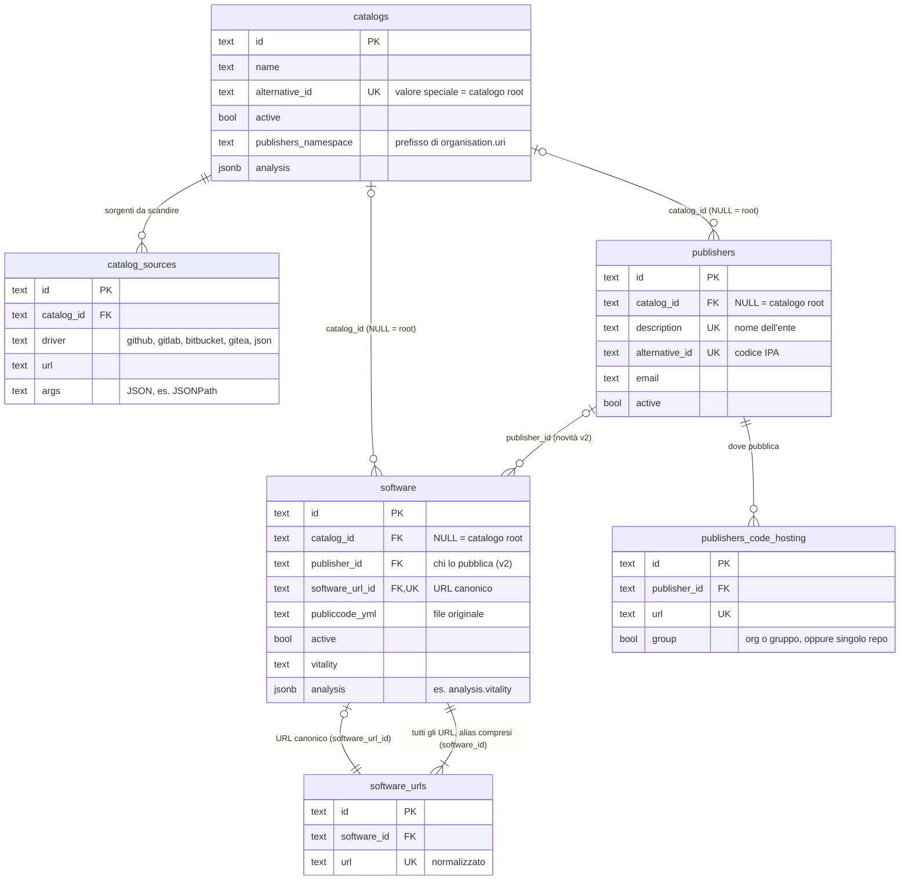

# @sw-catalog/db

Schema Prisma 7, migration e client del database Postgres del catalogo.

- `prisma/schema.prisma`: lo schema. Le tabelle che esistevano già in `developers-italia-api` (Go/GORM) hanno gli stessi nomi di tabelle e colonne (`@@map`/`@map`), così l'API TS può girare sul database attuale.
- `prisma/migrations/`: le migration. Due sono scritte a mano, perché Prisma non gestisce la deferrability dei vincoli (vedi sotto).
- `src/index.ts`: `getDb()`, il client condiviso, con il driver adapter `pg` richiesto da Prisma 7.
- `scripts/import-from-api.ts`: importa publisher e software da un'API v1 (default: produzione).

## Software, publisher e cataloghi

Tutte le tabelle hanno anche `created_at` e `updated_at`; nel diagramma sono omesse.

### Come leggere le relazioni

- **Catalogo root.** Publisher e software con `catalog_id` NULL appartengono al catalogo root, cioè quello di Developers Italia. Un catalogo "materializzato" con l'`alternative_id` speciale rappresenta lo stesso insieme.
- **Sorgenti.** Un catalogo elenca cosa scandire: org e gruppi sui code hosting, oppure un JSON da cui il driver `json` estrae gli URL dei repository. I publisher hanno invece i loro `publishers_code_hosting`, con `group` che distingue un'org intera da un singolo repository.
- **URL dei software.** Ogni software ha **un URL canonico** (`software.software_url_id`) e **tutti i suoi URL** in `software_urls` (`software_id`), compresi gli alias: per esempio il vecchio URL di un repository rinominato. Gli URL sono normalizzati (`normalizeUrl` di `@sw-catalog/shared`) e unici in tutta la tabella: lo stesso URL non può appartenere a due software.
- **Vincoli circolari.** Le due chiavi esterne tra `software` e `software_urls` sono entrambe NOT NULL e `DEFERRABLE INITIALLY DEFERRED`: dentro una transazione URL e software si inseriscono in qualsiasi ordine e i vincoli vengono controllati al commit. Cancellando un software si cancellano i suoi URL (`ON DELETE CASCADE`); il vincolo inverso è `NO ACTION` e non `RESTRICT`, che verrebbe controllato subito anche se deferrable.

### Il publisher di ogni software (novità della v2)

Nell'API Go non c'era modo di sapere quale publisher avesse pubblicato un software. Nella v2 c'è **`software.publisher_id`**, facoltativo, con chiave esterna verso `publishers` (`ON DELETE SET NULL`):

- **chi lo valorizza**: il crawler, con il publisher nel cui `publishers_code_hosting` ha trovato il repository. Nel flusso a cataloghi non lo imposta, perché lì il "publisher" è il catalogo stesso;
- **stabilità**: se un software ha già un publisher, il crawler non lo cambia (lo stesso repository può comparire nei code hosting di più enti) e scrive la differenza nel log. Lo si corregge dalla dashboard o con `PATCH /v2/software/:id`;
- **sincronizzazione** (`bun run db:sync-publishers`), da lanciare quando si vuole, per esempio dopo un import o dopo aver aggiunto o spostato dei code hosting. Le regole di abbinamento stanno in `src/publisher-match.ts` (con test):
  1. il code hosting più specifico che contiene uno degli URL del software (stesso repository se `group=false`, prefisso dell'org se `group=true`);
  2. altrimenti il codice IPA del `publiccode.yml` (`organisation.uri` o il vecchio `IT.riuso.codiceIPA`) confrontato con `publishers.alternative_id`.

  Cosa fa:
  - assegna il publisher ai software che non ce l'hanno;
  - **segnala senza cambiarli** quelli il cui publisher è diverso da quello che risulta dai code hosting (`--force` per allinearli);
  - lascia com'è un publisher già impostato quando non c'è più nessun riscontro (può essere un'assegnazione manuale);
  - riporta i casi ambigui (stesso code hosting per più enti) e quelli con il codice IPA del file diverso da quello del publisher;
  - `--dry-run` per vedere senza scrivere, `--verbose` per gli elenchi completi; non tocca `updated_at`.

  Sui dati di produzione del 9 novembre 2026: 577 software su 577 abbinati dal code hosting, nessun caso ambiguo
- **publisher e titolare possono essere diversi**: il codice IPA nel `publiccode.yml` indica il titolare del software, mentre `publisher_id` indica chi lo pubblica. Su 577 software, 467 coincidono, 101 non dichiarano un IPA (open source di terze parti) e 9 sono riusi, fork o registrazioni da verificare: per esempio `italia/design-scuole-wordpress-theme`, dell'org della PCM, è registrato come repository di un liceo, e solo lì.

## Le altre tabelle

| Tabella | A cosa serve |
|---|---|
| `logs` | Log del crawler, legati a un'entità con `entity_type`/`entity_id` (es. un software) |
| `webhooks`, `events` | Iscrizioni ai webhook e storico degli eventi che li fanno partire |
| `ipa_entities` | Anagrafica degli enti da IndicePA (codice IPA, sito, PEC, codice fiscale) |
| `onboarding_requests` | Richieste di onboarding delle PA |
| `third_party_requests` | Richieste di software di terze parti, dal form o da issue GitHub |
| `audit_events` | Storico dei passaggi delle richieste e delle operazioni fatte dalla dashboard |
| `dashboard_users`, `magic_link_tokens`, `dashboard_sessions` | Accesso alla dashboard: utenti (ruoli `ADMIN`/`VIEWER`), link di accesso, sessioni |

## Comandi

Dalla radice del monorepo (il `.env` della radice viene letto da `prisma.config.ts`):

| Comando | Cosa fa |
|---|---|
| `bun run db:migrate:deploy` | Applica le migration |
| `bun run db:migrate` | Crea una nuova migration dallo schema (`prisma migrate dev`) |
| `bun run db:generate` | Genera il client in `src/generated/prisma` (non versionato) |
| `bun run db:validate` | Valida lo schema |
| `bun run db:import [--only publishers\|software] [--limit N]` | Importa i dati di produzione |
| `bun run db:sync-publishers [--dry-run] [--force] [--verbose]` | Sincronizza `publisher_id` con publisher e code hosting (vedi sopra) |
| `bun run db:studio` | Prisma Studio nel compose locale: http://localhost:5555 |
